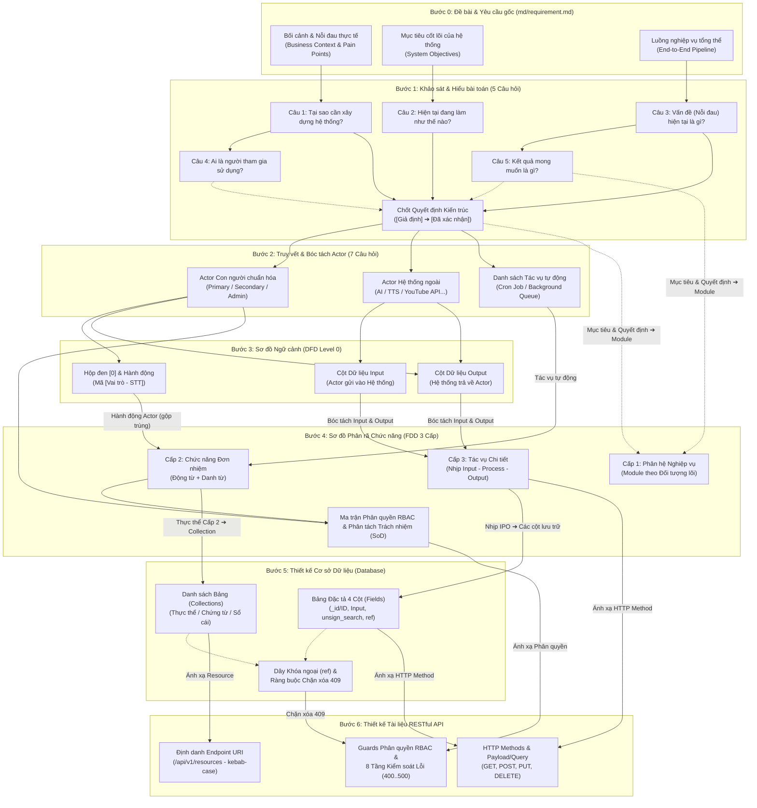

# CẨM NANG PHƯƠNG PHÁP LUẬN: MỐI LIÊN HỆ NHÂN QUẢ XUYÊN SUỐT TỪ KHẢO SÁT BÀI TOÁN ĐẾN ACTOR, DFD, FDD, DATABASE VÀ RESTFUL API

> **Mục đích tài liệu:** Giải thích chi tiết bản chất tư duy, nguồn gốc dữ liệu đầu vào/đầu ra và **mối liên hệ nhân quả (End-to-End Traceability)** xuyên suốt 6 bước phân tích & thiết kế hệ thống:
> **Bước 1 (5 Câu hỏi Khảo sát Bài toán)** ➔ **Bước 2 (7 Câu hỏi Truy vết Actor)** ➔ **Bước 3 (Sơ đồ Ngữ cảnh DFD Level 0)** ➔ **Bước 4 (Sơ đồ Phân rã Chức năng FDD 3 Cấp)** ➔ **Bước 5 (Thiết kế Database)** ➔ **Bước 6 (Thiết kế RESTful API)**.

---

## 1. Tổng quan Luồng Logic Phân tích Hệ thống

Trong kỹ thuật Phân tích & Thiết kế Hệ thống (System Analysis & Design), **không có bất kỳ Actor, Chức năng, Bảng Database hay API nào được nghĩ ra một cách cảm tính**. Đầu ra (Output) của bước trước chính là nguyên liệu đầu vào (Input) bắt buộc của bước kế tiếp:

---

## 2. Giải phẫu Bước 1: Khảo sát & Hiểu bài toán (`1_problem_survey_5_questions.md`)

**Mục đích cốt lõi:** Tránh lỗi nhảy ngay vào nghĩ bảng Database hay API khi chưa hiểu quy trình thực tế và nỗi đau của người dùng. Mọi bài toán phải đi qua chuỗi chuyển hóa: **Pain Points (Nỗi đau)** ➔ **Business Goals (Mục tiêu)** ➔ **System Boundary (Ranh giới)** ➔ **Acceptance Criteria (Tiêu chí nghiệm thu)**.

| Thứ tự | Câu hỏi khảo sát / Hạng mục | Bản chất câu hỏi tìm kiếm điều gì? | Nguồn dữ liệu (Ánh xạ từ bước trước) | Đầu ra cụ thể trong tài liệu Bước 1 |
|:---:|---|---|---|---|
| **Câu 1** | **Tại sao cần xây dựng hệ thống này?** | Xác định **Mục đích kinh doanh (Business Value)** và **Ranh giới hệ thống (System Boundary)** — hệ thống giải quyết bài toán lớn nào? | **Bước 0 (`md/requirement.md`):** Phần bối cảnh nghiệp vụ và lý do hình thành dự án. | 2–3 gạch đầu dòng tóm tắt lý do cốt lõi khiến hệ thống phải ra đời. |
| **Câu 2** | **Hiện tại quy trình đang làm như thế nào?** | Khảo sát **Quy trình thủ công hiện hữu (As-Is Process)**: công cụ rời rạc đang dùng, kênh phát sinh dữ liệu, các bước thao tác tay. | **Bước 0 (`md/requirement.md`):** Mô tả cách thức vận hành hiện tại trước khi có phần mềm. | Danh sách tuần tự các bước thủ công hiện tại (làm cơ sở phát hiện khâu cần tự động hóa). |
| **Câu 3** | **Vấn đề (Nỗi đau) hiện tại là gì?** | Tìm từng điểm nghẽn, sai sót, rủi ro trong quy trình ở Câu 2 để chuyển hóa trực tiếp thành **Mục tiêu hệ thống (System Objectives)**. | • **Bước 0:** Các rào cản/nỗi đau trong đề bài. • **Bước 1 (Câu 2):** Các bước thủ công gây tốn thời gian hoặc dễ nhầm lẫn. | Bảng 3 cột: `Vấn đề hiện tại \| Hệ quả \| Mục tiêu hệ thống tương ứng` |
| **Câu 4** | **Ai là người tham gia sử dụng?** | Phác thảo danh sách sơ bộ (chưa chuẩn hóa) những nhóm người hoặc đối tượng có chạm vào quy trình. | • **Bước 0:** Đối tượng người dùng nêu trong đề bài. • **Bước 1 (Câu 2):** Những người thực hiện các bước trong quy trình hiện tại. | Bảng 3 cột: `Nhóm đối tượng (thô) \| Căn cứ trong đề \| Nhu cầu chính` |
| **Câu 5** | **Kết quả mong muốn là gì?** | Định nghĩa **Tiêu chí nghiệm thu (Acceptance Criteria)** đo lường được cho từng mục tiêu hệ thống. | **Bước 1 (Câu 3):** Cột *"Mục tiêu hệ thống tương ứng"* vừa suy ra từ các nỗi đau. | Bảng 2 cột: `Mục tiêu hệ thống \| Tiêu chí đạt cụ thể (kiểm chứng được)` |
| **Chốt Bước 1** | **Làm rõ `[Giả định]` & Chốt Quyết định Kiến trúc** | Khóa chặt các chi tiết đề bài chưa nói rõ (hỏi tối đa 3 câu trọng tâm) để không phải đoán mò ở các bước sau. | Toàn bộ câu trả lời từ **Câu 1 đến Câu 5** của Bước 1. | Bảng tổng hợp **Các quyết định nghiệp vụ & kiến trúc `[Đã xác nhận]`**. |

---

## 3. Giải phẫu Bước 2: Truy vết & Bóc tách Tác nhân (`2_actor_identification_7_questions.md`)

**Mục đích cốt lõi:** Không đoán Actor cảm tính. Dùng trực tiếp kết quả trả lời 5 câu hỏi ở **Bước 1** để quét qua **7 câu hỏi truy vết**, từ đó tách bạch rõ **Actor (Con người & Hệ thống ngoài)** và **Tác vụ tự động chạy ngầm (Cron Job / Background Queue)**.

| Thứ tự | Câu hỏi truy vết Actor | Bản chất câu hỏi tìm kiếm điều gì? | Nguồn dữ liệu (Ánh xạ từ Bước 1) | Đầu ra chuẩn hóa trong tài liệu Bước 2 |
|:---:|---|---|---|---|
| **Câu 1** | **Ai trực tiếp đưa dữ liệu mới vào hệ thống?** | Tìm **Primary Actor** (người khởi phát quy trình, tạo mới dữ liệu đầu vào). | • **Bước 1 — Câu 2** (Quy trình hiện tại) • **Bước 1 — Câu 4** (Ai sử dụng) | Xác định vai trò người dùng chính trực tiếp thao tác nhập liệu/tạo yêu cầu. |
| **Câu 2** | **Ai tiếp nhận, duyệt hoặc xử lý bước tiếp theo?** | Tìm **Secondary Actor** (người tham gia xử lý tiếp quy trình sau khi có dữ liệu đầu vào). | • **Bước 1 — Câu 3** (Vấn đề quy trình) • **Bước 1 — Câu 4** (Ai sử dụng) | Xác định vai trò nhân sự/tác nhân xử lý, phê duyệt hoặc vận hành bước kế tiếp. |
| **Câu 3** | **Ai xem báo cáo, giám sát và ra quyết định?** | Tìm **Supervisory Actor** (người theo dõi tiến độ, xem thống kê, đối soát). | • **Bước 1 — Câu 4** (Ai sử dụng) • **Bước 1 — Câu 5** (Kết quả mong muốn) | Xác định vai trò quản lý/giám sát cần màn hình theo dõi tiến độ, dashboard, báo cáo. |
| **Câu 4** | **Khách hàng / Người dùng cuối tương tác trực tiếp hay gián tiếp?** | Phân biệt **Self-service User** (tự thao tác trên web/app) hay chỉ là **Data Entity** (do nội bộ nhập hộ). | • **Bước 1 — Câu 2** (Kênh tiếp nhận) • **Bước 1 — Câu 4** (Ai sử dụng) | Nếu tự thao tác ➔ Giữ làm **Actor**. Nếu chỉ được người khác nhập thông tin vào lưu trữ ➔ Loại khỏi Actor, chuyển thành **Bảng dữ liệu (`Entity`)** ở Bước 5. |
| **Câu 5** | **Hệ thống có trao đổi dữ liệu tự động với bên thứ 3 nào không?** | Tìm **External System Actor** (các hệ thống/API bên ngoài giao tiếp tự động hai chiều với hệ thống). | • **Bước 1 — Câu 1** (Ranh giới hệ thống) • **Bước 1 — Câu 5** (Kết quả mong muốn) | Danh sách các **Actor Hệ thống ngoài** (VD: Nền tảng nguồn dữ liệu, AI LLM API, TTS API, YouTube API, Cổng thanh toán...). |
| **Câu 6** | **Có nghiệp vụ nào tự động chạy ngầm theo thời gian/hàng đợi không?** | Tìm **Automated Process / Background Job** (Cron Job định kỳ hoặc Queue Worker xử lý bất đồng bộ). | • **Bước 1 — Câu 3** (Khâu thủ công hay quên/tốn sức) • **Bước 1 — Câu 5** (Tự động hóa) | **Bảng Danh sách Tác vụ tự động chạy ngầm** *(Lưu ý: Không vẽ thành Actor trên DFD Bước 3, nhưng bắt buộc đưa vào cây FDD ở Bước 4)*. |
| **Câu 7** | **Ai quản trị tài khoản, phân quyền và cấu hình nền tảng?** | Tìm **System Admin** (người quản lý tài khoản, vai trò RBAC, cấu hình tham số/nguồn dữ liệu). | • **Bước 1 — Câu 4** (Ai sử dụng) • **Bước 1 — Quyết định kiến trúc đã chốt** | Xác định vai trò Quản trị viên hệ thống (`Admin`) và phạm vi cấu hình nền tảng. |
| **Chốt Bước 2** | **Chuẩn hóa theo 4 Quy tắc Loại trừ** | Gộp chức danh trùng quyền; loại bỏ `Entity` thụ động; loại bỏ hệ thống ngoài thủ công; tách riêng `Cron Job`. | Toàn bộ kết quả quét từ **Câu 1 đến Câu 7** của Bước 2. | **Bảng 1:** Danh sách Actor chuẩn hóa (Con người & Hệ thống ngoài). **Bảng 2:** Danh sách Tác vụ tự động chạy ngầm. |

---

## 4. Giải phẫu Bước 3: Thiết kế Sơ đồ Ngữ cảnh DFD Level 0 (`3_dfd_level_0_standard.md`)

**Mục đích cốt lõi:** Nhìn hệ thống từ **bên ngoài vào như một Hộp đen (`[0] Tên Hệ Thống`)** để xác định rõ: **Ai (Actor nào)** gửi **Dữ liệu Input gì** vào hệ thống và nhận lại **Dữ liệu Output gì** từ hệ thống.

| Hạng mục / Câu hỏi thiết kế ở Bước 3 | Bản chất tìm kiếm điều gì? | Nguồn dữ liệu (Ánh xạ từ các bước trước) | Quy tắc biểu diễn & Đầu ra chuẩn ở Bước 3 |
|---|---|---|---|
| **1. Khối trung tâm của sơ đồ là gì?** | Xác định ranh giới Hộp đen duy nhất đại diện cho toàn bộ phần mềm (chưa mở hộp đen, không vẽ bảng DB hay module con). | • **Bước 0 (`md/requirement.md`):** Tên hệ thống. • **Bước 1 (Câu 1):** Ranh giới hệ thống. | Vẽ 1 khối trung tâm duy nhất: **`[0] Tên Hệ Thống`**. |
| **2. Những thực thể nào được đặt xung quanh Hộp đen?** | Xác định các tác nhân bên ngoài có trao đổi luồng dữ liệu trực tiếp với hệ thống. | **Bước 2 — Bảng 1:** Danh sách Actor chuẩn hóa (gồm cả Actor Con người và Actor Hệ thống ngoài). *(Tuyệt đối không vẽ Bảng 2: Cron Job/Queue lên DFD Level 0)*. | Các khối Actor đặt xung quanh `[0] Tên Hệ Thống`. |
| **3. Mỗi Actor thực hiện những hành động tương tác nào?** | Liệt kê đầy đủ các hành động mà từng Actor khởi phát hoặc tiếp nhận kết quả, gắn mã định danh rõ nghĩa. | • **Bước 1 — Câu 4 & Câu 5:** Nhu cầu của từng nhóm đối tượng và tiêu chí đạt. • **Bước 2 — Câu 1..5, Câu 7:** Vai trò và trách nhiệm của từng Actor. | Mã hóa theo cú pháp bắt buộc: **`[Tên vai trò - STT]`** (VD: `[Người dùng - 01]`, `[Quản trị - 02]`). Cấm viết tắt tối nghĩa (`ND1`, `QT2`). |
| **4. Luồng dữ liệu đi vào (Input) và đi ra (Output) gồm những gì?** | Xác định cặp mũi tên đối xứng 2 chiều cho mỗi hành động: Actor gửi trường thông tin gì vào và nhận kết quả gì về? | • **Bước 1 — Quyết định kiến trúc đã chốt**. • **Bước 2 — Mô tả tương tác của từng Actor**. | • **Mũi tên Input:** `[Vai trò - STT] Động từ + Danh từ` • **Mũi tên Output:** `[Vai trò - STT] Kết quả + tên hành động` • **Bảng Actor - Hành động 7 cột:** `Actor \| Mã \| Hành động \| Nhãn Input \| Dữ liệu Input \| Nhãn Output \| Dữ liệu Output`. |

---

## 5. Giải phẫu Bước 4: Sơ đồ Phân rã Chức năng FDD 3 Cấp & RBAC (`4_fdd_and_rbac_standard.md`)

**Mục đích cốt lõi:** Mở Hộp đen hệ thống ra, chuyển góc nhìn từ **"Ai làm (Who - Bước 3)"** sang **"Hệ thống có những chức năng gì (What - Bước 4)"** theo nguyên tắc **MECE** (Không trùng lặp - Không bỏ sót) và cú pháp **`Động từ + Danh từ`**.

| Cấp / Thành phần ở Bước 4 | Bản chất tìm kiếm điều gì? | Nguồn dữ liệu (Ánh xạ từ Bước 1, 2, 3) | Quy tắc chuyển đổi & Công thức chuẩn ở Bước 4 |
|---|---|---|---|
| **Cấp 0 (Root Node)** | Tên tổng thể của hệ thống trên đỉnh cây FDD. | • **Bước 0 (`md/requirement.md`)** • **Bước 3:** Khối trung tâm `[0] Tên Hệ Thống`. | 1 nút gốc duy nhất mang tên hệ thống. |
| **Cấp 1: Phân hệ Nghiệp vụ (4–6 Module)** | Chia hệ thống thành các khối phân hệ lớn độc lập tương đối. *(Tuyệt đối không lấy tên Actor làm nhánh Cấp 1)*. | • **Bước 1 — Câu 5:** Các mục tiêu cốt lõi của hệ thống. • **Bước 1 — Quyết định kiến trúc đã chốt**. | Gom nhóm các mục tiêu hệ thống theo **Đối tượng dữ liệu trung tâm (Core Entity)**, đặt tên theo `Động từ + Danh từ` (VD: *Quản lý nguồn truyện*, *Quản lý dịch thuật & TTS*...). |
| **Cấp 2: Chức năng Nghiệp vụ (Đơn nhiệm)** | Xác định từng chức năng đơn nhiệm cụ thể nằm trong mỗi phân hệ Cấp 1 (mỗi chức năng chỉ xuất hiện duy nhất 1 lần trên toàn cây). | • **Bước 3 — Bảng 7 cột:** Cột *"Hành động"* của tất cả các Actor. • **Bước 2 — Bảng 2:** Danh sách *"Tác vụ tự động chạy ngầm (Cron Job / Queue)"*. | Áp dụng công thức bảo toàn bắt buộc: **Tổng Chức năng Cấp 2 = Tổng Hành động Actor (Bước 3) − Số Hành động trùng giữa các Actor + Số Tác vụ tự động (Bước 2)**. Bắt đầu bằng `Động từ + Danh từ`. |
| **Cấp 3: Tác vụ Chi tiết (Nhịp IPO)** | Bóc tách từng chức năng Cấp 2 thành các bước xử lý chi tiết theo đúng trình tự luồng dữ liệu. | • **Bước 3 — Bảng 7 cột:** Cột *"Dữ liệu Input (Actor gửi vào)"* và Cột *"Dữ liệu Output (Actor nhận lại)"* của hành động tương ứng. | Tách thành 3 nhịp **IPO** rõ ràng: 1. **Input:** Nhập / chọn / lọc dữ liệu đầu vào. 2. **Process:** Kiểm tra ràng buộc, xử lý / tính toán lõi. 3. **Output:** Lưu trạng thái, đẩy hàng đợi / trả kết quả. |
| **Ma trận Phân quyền RBAC & SoD** | Xác định Role nào được quyền truy cập (`read`, `write`, `delete`) vào chức năng Cấp 2 nào và dự kiến ánh xạ vào bảng DB nào. | • **Bước 2 — Bảng 1:** Danh sách các Role con người. • **Bước 3 — Cột Actor:** Ai thực hiện hành động nào. • **Bước 4 — Cấp 2:** Danh sách chức năng đơn nhiệm. | Lập bảng truy vết 6 cột: `STT \| Mã FDD \| Tên chức năng Cấp 2 \| Nguồn (Bước 2 & 3) \| Bảng DB dự kiến \| Quyền theo từng Role` *(Đảm bảo Phân tách trách nhiệm - SoD)*. |

---

## 6. Giải phẫu Bước 5: Thiết kế Cơ sở Dữ liệu (`3-database/`)

**Mục đích cốt lõi:** Không tự nghĩ ra bảng hay cột theo cảm tính. Toàn bộ **Danh sách Bảng (Collections)**, **Các Trường (Fields)** và **Ràng buộc Khóa ngoại** ở Bước 5 đều được dịch trực tiếp từ **Bước 3** và **Bước 4**.

### 6.1. Bảng Ánh xạ từ Chức năng Cấp 2 (Bước 4) ➔ Danh sách Bảng (`Collections`)

| Câu hỏi phân loại Chức năng Cấp 2 | Bản chất tìm kiếm điều gì? | Nguồn dữ liệu (Ánh xạ từ Bước 4) | Quy tắc thiết kế Database ở Bước 5 |
|---|---|---|---|
| **1. Danh từ của chức năng là Thực thể độc lập (Master Entity)?** | Đối tượng có vòng đời tạo mới, cập nhật, tìm kiếm, khóa/xóa độc lập (VD: nhân viên, danh mục, bộ truyện...). | **Bước 4 — Nhánh Cấp 2** thuộc nhóm quản lý danh mục / thực thể cốt lõi & Cột *"Bảng DB dự kiến"* trong bảng RBAC. | Sinh ra **1 Collection độc lập** tương ứng (đặt tên danh từ số nhiều, `snake_case`: `users`, `categories`, `novels`...). |
| **2. Danh từ của chức năng là Thuộc tính / Phạm vi phụ thuộc vào Thực thể cha?** | Thông tin cấu hình hoặc phạm vi gán thêm không tồn tại độc lập ngoài thực thể cha (VD: gán kho phụ trách cho nhân viên, gán mã SKU cho sản phẩm). | **Bước 4 — Nhánh Cấp 2** thuộc nhóm gán quyền hạn/phạm vi hoặc cấu hình thuộc tính con. | **KHÔNG tạo bảng mới!** Ánh xạ thành **1 Trường (`Field`) hoặc Mảng (`Array`)** nhúng ngay trong bảng của Thực thể cha (VD: `employees.warehouse_ids`, `subcategories.sku`). |
| **3. Chức năng là Phiên xác thực, Chứng từ giao dịch hay Tiến trình chạy ngầm?** | Nghiệp vụ phát sinh theo thời gian, cần lưu vết phiên, lịch sử giao dịch, hàng đợi xử lý hoặc sổ cái đối soát. | • **Bước 4 — Nhánh Cấp 2** nhóm xác thực / giao dịch / tác vụ ngầm. • **Bước 2 — Bảng 2:** Danh sách Tác vụ tự động (Cron/Queue). | Sinh ra **Bảng Phiên / Chứng từ / Hàng đợi / Sổ cái** (`refresh_tokens`, `import_form`, `video_jobs`, `debts`, `stock_histories`...). |

### 6.2. Bảng Ánh xạ sang 4 Nhóm Trường (`Fields`) trong Bảng Đặc tả 4 Cột (`field | type | required | des`)

| Nhóm Trường trong mỗi Bảng | Bản chất câu hỏi tìm kiếm điều gì? | Nguồn dữ liệu (Ánh xạ từ Bước 3 & Bước 4) | Quy tắc khai báo Trường chuẩn ở Bước 5 |
|---|---|---|---|
| **Nhóm 1: Khung Định danh & Hệ thống** | Mọi bản ghi trong hệ thống cần những trường nền tảng nào để định danh, quản lý trạng thái khóa mềm và vết thời gian? | Quy ước chuẩn toàn hệ thống tại `3-database/3_db_field_conventions.md`. | • `_id`: `ObjectId, true` (khóa chính & tham chiếu `ref`) • `ID`: `String/Number, unique` (mã nghiệp vụ nếu có) • `status`: `Number, Index, true, default = 1` (`1` hoạt động, `0` khóa) • `createdAt`, `updatedAt`: bật `timestamps: true` |
| **Nhóm 2: Các Trường Lưu trữ Đầu vào (Input Fields)** | Khi Actor gọi Tạo mới (`POST`) hoặc Cập nhật (`PUT`), hệ thống phải có những cột nào để hứng dữ liệu gửi lên? | • **Bước 3 — Cột *"Dữ liệu Input (Actor gửi vào)"*** trong Bảng 7 cột. • **Bước 4 — Nhánh Cấp 3 (Nhịp 1 - Input)**. | Tạo đúng các trường `snake_case` tương ứng với dữ liệu đầu vào (`name`, `phone`, `price`...). Riêng `password` và `token` mã hóa **`sha512`** (`select: false` cho `password`). |
| **Nhóm 3: Các Trường Tính toán & Đầu ra (Computed / Output Fields)** | Hệ thống cần tự sinh hoặc tự tính thêm những cột nào để phục vụ tìm kiếm tiếng Việt, tổng hợp số liệu hoặc kiểm soát hạn dùng? | • **Bước 3 — Cột *"Dữ liệu Output (Actor nhận lại)"***. • **Bước 4 — Nhánh Cấp 3 (Nhịp 2 - Process & Nhịp 3 - Output)**. | • Có tìm kiếm tiếng Việt theo tên/mã ➔ Bắt buộc thêm `unsign_search: String, Index` (lưu cả có dấu & không dấu chữ thường). • Có tính tổng tiền/thời hạn ➔ Thêm `total_amount: Number, default = 0`, `expired_at: Date`... |
| **Nhóm 4: Các Trường Khóa ngoại (Foreign Keys) & Toàn vẹn tham chiếu** | Bảng này liên kết cha-con hoặc tham chiếu ($1-N$) tới bảng nào khác? Khi nào phải chặn xóa cứng? | • **Bước 4 — Mối liên hệ giữa các nhánh trên cây FDD**. • **Bước 5 — Sơ đồ liên kết giữa các Collection**. | • Phân cấp cha-con cùng bảng ➔ `parent_id: ObjectId, default: null, Index`. • Tham chiếu bảng khác ➔ `<ten_bang>_id: ObjectId, Index`. • Mọi dây khóa ngoại trỏ vào Bảng A sẽ sinh ra quy tắc **Chặn xóa cứng `409 CONFLICT`** trên Bảng A. |

### 6.3. Bảng Ánh xạ Khóa ngoại & Quy tắc Toàn vẹn Tham chiếu (`4_db_referential_integrity.md`)

| Hạng mục / Câu hỏi kiểm soát toàn vẹn | Bản chất tìm kiếm điều gì? | Nguồn dữ liệu (Ánh xạ từ Bước 4 & Mục 6.1, 6.2) | Quy tắc Ràng buộc & Xóa/Khóa ở Bước 5 |
|---|---|---|---|
| **1. Bản ghi nào cấm xóa cứng tuyệt đối?** | Bảo vệ lịch sử định danh và phân quyền của hệ thống. | Các bảng Tài khoản người dùng (`users`/`employees`) và Vai trò (`roles`). | **Tuyệt đối không có API xóa cứng (`DELETE`)**; chỉ khóa mềm bằng `PUT /:id/status` (`status = 0`). |
| **2. Khi nào được xóa cứng (`DELETE`) và khi nào phải chặn `409 CONFLICT`?** | Chống dữ liệu mồ côi (Orphaned Records) khi xóa danh mục hoặc dữ liệu nguồn. | Toàn bộ các **Trường Khóa ngoại (`ref`)** ở Nhóm 4 (Mục 6.2) trỏ về `_id` của Bảng đang xét. | • Chưa có bảng nào tham chiếu ➔ Cho phép xóa cứng (`200 OK`). • Đã có bản ghi tham chiếu (con, sản phẩm, chứng từ, tiến trình) ➔ **Chặn xóa `409 CONFLICT`**, yêu cầu khóa mềm (`status = 0`). |
| **3. Kiểm tra gì khi truyền khóa ngoại lúc Tạo mới (`POST`) / Cập nhật (`PUT`)?** | Đảm bảo khóa ngoại hợp lệ và cây phân cấp không bị lặp vô hạn. | Các trường `<ten_bang>_id` và `parent_id` trong Request Body. | • Khóa ngoại phải tồn tại và đang hoạt động (`status = 1`), nếu không trả `404 NOT_FOUND`. • Với `parent_id`, kiểm tra chống trỏ vòng lặp vào chính nó hoặc con của nó (sai trả `400 VALIDATION_ERROR`). |

---

## 7. Giải phẫu Bước 6: Thiết kế Tài liệu RESTful API (`4-api/`)

**Mục đích cốt lõi:** Chuyển hóa toàn bộ thiết kế Chức năng (**Bước 4**) và Cơ sở dữ liệu (**Bước 5**) thành **Tài liệu Đặc tả API chuẩn 4 Phần** (`4-api/api_doc_and_postman_standard.md`) trước khi viết code Backend/Frontend ở Bước 7.

| Bố cục 4 Phần & Câu hỏi thiết kế ở Bước 6 | Bản chất tìm kiếm điều gì? | Nguồn dữ liệu (Ánh xạ từ Bước 2, 3, 4, 5) | Quy chuẩn đầu ra trong Tài liệu API ở Bước 6 |
|---|---|---|---|
| **Mục 1 — Quy ước chung & Ma trận Phân quyền (RBAC)** | Role nào có quyền `<resource>.<action>` (`read`, `write`, `delete`) trên Resource nào? | **Bước 4 — Bảng Ma trận Phân quyền RBAC & SoD**. | Bảng tổng hợp quyền của từng Role và danh mục mã quyền `<resource>.<action>` dùng cho `JwtAuthGuard` + `RolesGuard` / `ScopeGuard`. |
| **Mục 2 — Bảng Danh sách Tổng hợp API (URI & HTTP Methods)** | Hệ thống có tổng cộng bao nhiêu Endpoint, ánh xạ từ chức năng FDD nào? | • **Bước 5 (Mục 6.1):** Tên Collection (`snake_case`). • **Bước 4 (Cấp 2 & Cấp 3):** Mã FDD & Nhịp IPO. • **Bước 2 (Bảng 2):** Tác vụ chạy ngầm (Queue). | • Bảng 5 cột: `# \| Method \| Endpoint \| Chức năng (Mã FDD) \| Quyền`. • URI: `/api/v1/<resources>` (danh từ số nhiều, `kebab-case`, route tĩnh đặt trên `/:id`). • Method: `GET`, `POST` (`201`/`202`), `PUT` (**cấm dùng `PATCH`**, tách sub-resource `PUT /:id/status`, `/role`, `/password`), `DELETE` (`200`). |
| **Mục 3 — Đặc tả Chi tiết từng API (Payload, Query, Logic ngầm, Response, Lỗi)** | Mỗi API nhận dữ liệu gì, validate ra sao, xử lý ngầm gì và trả về cấu trúc JSON nào? | • **Bước 3 (Bảng 7 cột):** Cột *"Dữ liệu Input"* & *"Dữ liệu Output"*. • **Bước 4 (Cấp 3):** Nhịp 1 (Input), Nhịp 2 (Process), Nhịp 3 (Output). • **Bước 5 (Mục 6.2):** Bảng đặc tả 4 cột. | • **Query Params (`GET`):** `camelCase` (`page`, `limit`, `keyword`, `status`, `fromDate`, `toDate`). • **Request / Response Body:** `snake_case`, bọc `{ "data": ... }` / `{ "error": ... }` (không có `statusCode` trong body; ẩn `password`, `unsign_search`, `__v`). • **8 Tầng mã lỗi:** `401` ➔ `403` ➔ `400` ➔ `404` ➔ `409` ➔ `429` ➔ `502/504` ➔ `500`. |
| **Mục 4 — Bảng Tổng hợp Điều kiện Chặn xóa (`409 CONFLICT`)** | Endpoint `DELETE /api/v1/<resources>/:id` nào phải chặn xóa khi đã phát sinh dữ liệu liên quan? | **Bước 5 (Mục 6.2 & 6.3):** Toàn bộ dây Khóa ngoại (`ref`) trỏ vào từng Collection. | Bảng liệt kê từng Endpoint `DELETE` và danh sách cụ thể các `Bảng.Trường` tham chiếu cần kiểm tra trước khi xóa. |

---

## 8. Tóm tắt Quy trình Tài liệu Thực hành Chuẩn cho Mọi Dự án Mới

Khi bắt đầu bất kỳ dự án mới nào, chỉ cần đi tuần tự từng bước trong thư mục `md/` (tuân thủ Phase Gate tại `1-core/workflow_phases.md` — hoàn thành và xác nhận từng bước trước khi qua bước kế tiếp):
1. **`md/requirement.md` (Bước 0):** Đề bài, bối cảnh, nỗi đau và các mục tiêu tổng thể.
2. **`md/1-khao-sat-bai-toan.md` (Bước 1):** Trả lời 5 câu hỏi khảo sát bài toán, làm rõ các `[Giả định]` và chốt bảng Quyết định kiến trúc `[Đã xác nhận]`.
3. **`md/2-truy-vet-actor.md` (Bước 2):** Từ kết quả Bước 1, quét 7 câu hỏi truy vết để chốt Bảng 1 (Actor chuẩn hóa) và Bảng 2 (Tác vụ tự động).
4. **`md/3-so-do-ngu-canh-dfd.md` (Bước 3):** Lập bảng Actor - Hành động 7 cột (mã `[Vai trò - STT]`, Input, Output) và vẽ sơ đồ ngữ cảnh DFD Level 0.
5. **`md/4-so-do-phan-ra-chuc-nang-fdd.md` (Bước 4):** Áp dụng công thức chuyển đổi từ Bước 1, 2, 3 sang cây FDD 3 cấp chuẩn MECE và bảng Ma trận phân quyền RBAC.
6. **`md/5-thiet-ke-database.md` (hoặc `md/analysis/db/*.md` — Bước 5):** Ánh xạ từ FDD & DFD sang bảng đặc tả Database 4 cột chuẩn (`field | type | required | des`).
7. **`md/6-tai-lieu-api.md` (hoặc `md/api-module-xx.md` — Bước 6):** Đặc tả chi tiết RESTful API theo đúng bố cục 4 phần chuẩn và thiết lập Collection kiểm thử.
