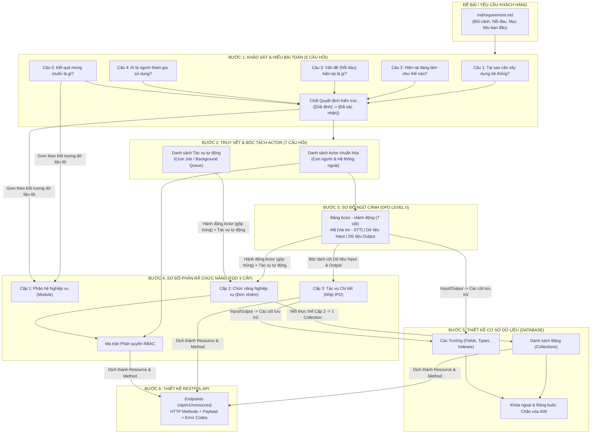
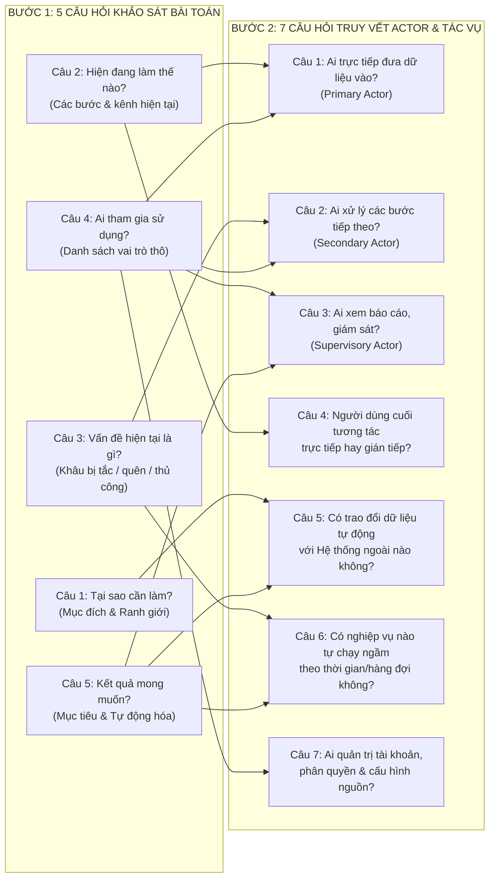
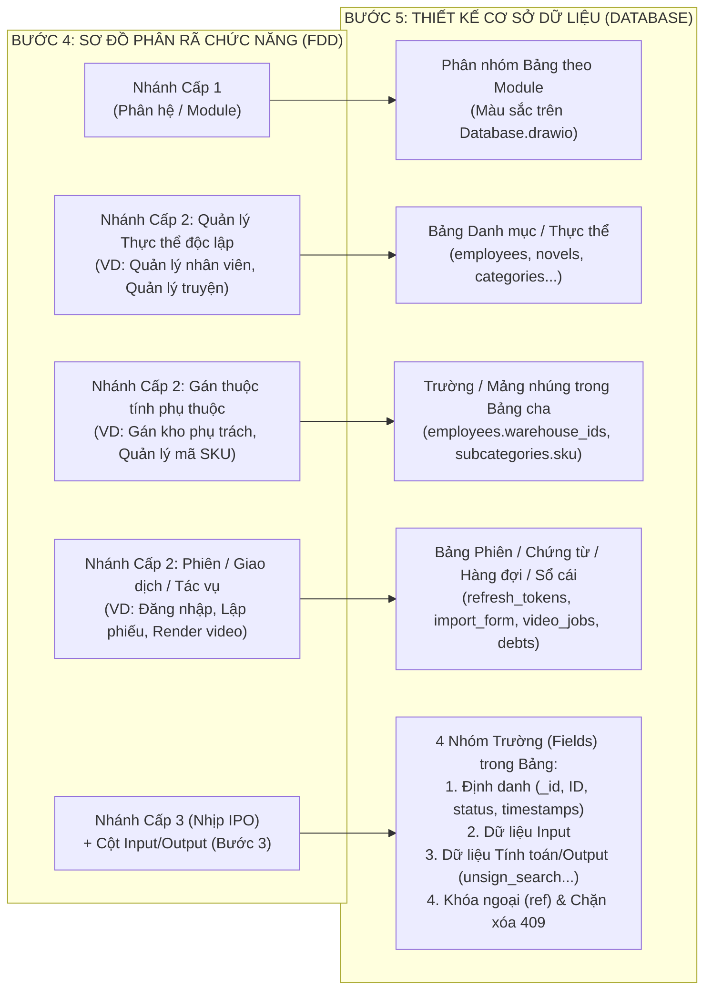

# CẨM NANG PHƯƠNG PHÁP LUẬN: MỐI LIÊN HỆ NHÂN QUẢ XUYÊN SUỐT TỪ KHẢO SÁT BÀI TOÁN ĐẾN ACTOR, DFD, FDD, DATABASE VÀ RESTFUL API

> **Mục đích tài liệu:** Giải thích chi tiết bản chất tư duy, nguồn gốc dữ liệu đầu vào/đầu ra và **mối liên hệ nhân quả (End-to-End Traceability)** xuyên suốt 6 bước phân tích & thiết kế hệ thống:
> **Bước 1 (5 Câu hỏi Khảo sát Bài toán)** ➔ **Bước 2 (7 Câu hỏi Truy vết Actor)** ➔ **Bước 3 (Sơ đồ Ngữ cảnh DFD Level 0)** ➔ **Bước 4 (Sơ đồ Phân rã Chức năng FDD 3 Cấp)** ➔ **Bước 5 (Thiết kế Database)** ➔ **Bước 6 (Thiết kế RESTful API)**.

---

## 1. Tổng quan Sơ đồ Dòng chảy Nhân quả Toàn Hệ thống

Trong kỹ thuật Phân tích & Thiết kế Hệ thống (System Analysis & Design), **không có bất kỳ Actor, Chức năng, Bảng Database hay API nào được nghĩ ra một cách cảm tính**. Đầu ra (Output) của bước trước chính là nguyên liệu đầu vào (Input) bắt buộc của bước kế tiếp:

---

## 2. Giải phẫu Bước 1: Năm Câu hỏi Khảo sát & Hiểu bài toán (`1_problem_survey_5_questions.md`)

### 2.1. Tại sao phải trả lời 5 câu hỏi khảo sát trước tiên?
Khi mới đọc đề bài, lập trình viên thường mắc lỗi nhảy ngay vào nghĩ *"Cần tạo bảng DB gì, viết API gì?"*. Khi chưa hiểu gốc rễ quy trình hiện tại và nỗi đau thực sự của người dùng, thiết kế sẽ bị lệch mục tiêu hoặc bỏ sót các luồng xử lý ngầm.

### 2.2. Bảng Giải thích Chi tiết 5 Câu hỏi Khảo sát Bài toán

| Thứ tự | Câu hỏi khảo sát | Bản chất câu hỏi tìm kiếm điều gì? | Đầu ra cụ thể trong tài liệu Bước 1 |
|:---:|---|---|---|
| **Câu 1** | **Tại sao cần xây dựng hệ thống này?** | Xác định **Mục đích kinh doanh (Business Value)** và **Ranh giới hệ thống (System Boundary)** — hệ thống giải quyết bài toán lớn nào? | 2–3 gạch đầu dòng tóm tắt lý do cốt lõi khiến hệ thống phải ra đời. |
| **Câu 2** | **Hiện tại quy trình đang làm như thế nào?** | Khảo sát **Quy trình hiện hữu (As-Is Process)**: khi chưa có phần mềm này, người dùng phải dùng những công cụ rời rạc nào và thao tác tay qua mấy bước? | Danh sách các bước thủ công hiện tại (giúp phát hiện những điểm cần tự động hóa). |
| **Câu 3** | **Vấn đề (Nỗi đau) hiện tại là gì?** | Chỉ ra từng điểm nghẽn, sai sót, rủi ro trong cách làm ở Câu 2 và ánh xạ thẳng sang **Mục tiêu hệ thống (System Objectives)**. | Bảng 3 cột: `Vấn đề hiện tại \| Hệ quả \| Mục tiêu hệ thống tương ứng` |
| **Câu 4** | **Ai là người tham gia sử dụng?** | Liệt kê danh sách sơ bộ (chưa chuẩn hóa) những con người hoặc đối tượng có liên quan đến quy trình. | Bảng 3 cột: `Nhóm người dùng (thô) \| Căn cứ trong đề \| Nhu cầu chính` |
| **Câu 5** | **Kết quả mong muốn là gì?** | Định nghĩa **Tiêu chí nghiệm thu (Acceptance Criteria)** cho từng mục tiêu hệ thống: dựa vào đâu để biết hệ thống đã đạt yêu cầu? | Bảng 2 cột: `Mục tiêu hệ thống \| Tiêu chí đạt cụ thể` |

---

## 3. Mối liên hệ Nhân quả từ Bước 1 (5 Câu hỏi Khảo sát) ➔ Bước 2 (7 Câu hỏi Truy vết Actor)

Không có câu hỏi nào ở Bước 2 tự nhiên sinh ra. **Mỗi câu trả lời ở Bước 1 sẽ cung cấp dữ liệu trực tiếp để trả lời các câu hỏi truy vết Actor ở Bước 2**:

### Bảng Đối chiếu Nhân quả Bước 1 ➔ Bước 2

| Câu trả lời ở Bước 1 | Suy ra câu hỏi nào ở Bước 2? | Ví dụ thực tế cách suy luận |
|---|---|---|
| **Câu 1 (Tại sao cần làm)** & **Câu 5 (Kết quả mong muốn)** | ➔ **Câu 5 (Hệ thống ngoài - External Systems)** | Đề bài yêu cầu tự động lấy truyện Trung, dịch AI, chuyển giọng đọc TTS, đăng YouTube ➔ Suy ra hệ thống bắt buộc phải giao tiếp với các **External Systems**: *Nền tảng truyện Trung Quốc, Dịch vụ AI Dịch thuật (LLM), Dịch vụ Text-to-Speech (TTS), và YouTube Data API*. |
| **Câu 2 (Hiện đang làm thế nào)** | ➔ **Câu 1 (Ai nhập dữ liệu)** & **Câu 4 (Tương tác trực tiếp/gián tiếp)** | Người làm kênh tự chọn truyện, bấm tạo dự án video và cấu hình lịch đăng trên web ➔ Người dùng là **Primary Actor** trực tiếp thao tác. |
| **Câu 3 (Vấn đề hiện tại)** & **Câu 5 (Kết quả mong muốn)** | ➔ **Câu 2 (Ai xử lý bước tiếp)** & **Câu 6 (Tác vụ tự động chạy ngầm)** | Vấn đề là người dùng không biết dựng video, hay quên lịch đăng và mất thời gian dịch hàng trăm chương ➔ Suy ra ở **Câu 6** phải có các **Tác vụ tự động (Background Jobs / Cron Jobs)**: *Tự động quét truyện hot định kỳ, Hàng đợi dịch & tạo audio hàng loạt, Tự động render ghép video FFmpeg, Tự động đẩy video lên YouTube khi đến giờ hẹn*. |
| **Câu 4 (Ai sử dụng)** | ➔ **Câu 1, 2, 3, 7 (Chuẩn hóa các Vai trò con người)** | Từ danh sách người dùng thô ở Câu 4, tách bạch thành các vai trò chuẩn: **Nhà sáng tạo nội dung / Người dùng (`Creator/User`)** và **Quản trị viên hệ thống (`Admin`)** (cấu hình nguồn cào truyện, cấu hình API key AI/TTS, quản lý người dùng). |

---

## 4. Mối liên hệ Nhân quả từ Bước 2 & Bước 3 (Actor & DFD Level 0) ➔ Bước 4 (Sơ đồ Phân rã Chức năng FDD 3 Cấp)

### 4.1. Sự khác biệt cốt lõi giữa DFD Level 0 (Bước 3) và FDD (Bước 4)

| Tiêu chí | Bước 3: Sơ đồ Ngữ cảnh DFD Level 0 | Bước 4: Sơ đồ Phân rã Chức năng (FDD 3 Cấp) |
|---|---|---|
| **Góc nhìn** | Nhìn **từ ngoài vào** hộp đen hệ thống | Mở hộp đen ra, nhìn **cấu trúc bên trong** hệ thống |
| **Câu hỏi trung tâm** | **Ai (Who)** tương tác và gửi/nhận luồng dữ liệu gì? | Hệ thống có **những khối chức năng gì (What)**? |
| **Cách chia nhánh** | Chia theo **Actor** (`[Người dùng - 01..N]`, `[Quản trị - 01..M]`) | Chia theo **Miền nghiệp vụ / Đối tượng dữ liệu lõi (Core Entity)** theo nguyên tắc **MECE** (Không trùng lặp - Không bỏ sót) |
| **Tác vụ tự động (Cron/Queue)** | **Không vẽ** lên DFD Level 0 (vì chạy ngầm bên trong hệ thống, không phải Actor ngoài) | **Bắt buộc phải xuất hiện** thành các chức năng trên cây FDD |

### 4.2. Bảng Đối chiếu Nguồn Dữ liệu cho từng Cấp của Sơ đồ FDD (Bước 4)

Toàn bộ cây FDD 3 cấp ở Bước 4 được **chuyển đổi toán học 100%** từ kết quả của Bước 1, Bước 2 và Bước 3:

| Cấp trên sơ đồ FDD | Lấy dữ liệu nguồn từ đâu? | Quy tắc chuyển đổi thành nút chức năng trên FDD |
|---|---|---|
| **Cấp 0: Tên Hệ thống** | Đề bài (`md/requirement.md`) | Tên tổng thể của hệ thống. |
| **Cấp 1: Phân hệ lớn (4–6 khối Module)** | • **Bước 1 — Câu 5** (Các mục tiêu của hệ thống) • **Bước 1 — Các quyết định đã chốt** | Gom các mục tiêu hệ thống theo **Đối tượng dữ liệu trung tâm (Core Entity)** (Ví dụ: *1. Quản lý nguồn truyện & khám phá*, *2. Quản lý dịch thuật AI & giọng đọc TTS*, *3. Quản lý dựng video & xuất bản YouTube*, *4. Quản trị hệ thống & cấu hình*). |
| **Cấp 2: Chức năng nghiệp vụ (Đơn nhiệm)** | • **Bước 3 — Cột "Hành động"** trong Bảng Actor - Hành động • **Bước 2 — Bảng "Tác vụ tự động"** | Áp dụng công thức bảo toàn: **Số chức năng Cấp 2 = Tổng hành động Actor (Bước 3) − Số hành động trùng giữa các Actor + Số tác vụ tự động (Bước 2)**. Mọi tên chức năng đều bắt đầu bằng **`Động từ + Danh từ`**. |
| **Cấp 3: Tác vụ chi tiết (Các bước con)** | • **Bước 3 — Cột "Dữ liệu Input"** và **Cột "Dữ liệu Output"** của từng dòng hành động | Nhìn vào `Dữ liệu Input` và `Dữ liệu Output` của chức năng đó để tách thành 2–3 bước theo nhịp **IPO**: 1. *Input:* Nhập / chọn / lọc dữ liệu gì? 2. *Process:* Hệ thống kiểm tra điều kiện hay xử lý ngầm gì? 3. *Output:* Lưu bản ghi / sinh file / trả kết quả gì? |

---

## 5. Mối liên hệ Nhân quả từ Bước 4 (Sơ đồ FDD) ➔ Bước 5 (Thiết kế Cơ sở Dữ liệu - Database Design)

Nhiều người sau khi vẽ xong sơ đồ FDD lại bỏ FDD sang một bên rồi tự nghĩ ra các bảng Database theo cảm tính. Trong kiến trúc hệ thống chuẩn, **Database là bản dịch trực tiếp 1:1 từ Sơ đồ FDD (Bước 4) và Bảng Input/Output (Bước 3)**:

### 5.1. Quy tắc 1: Ánh xạ từ Nhánh Cấp 2 của FDD ➔ Danh sách Bảng (Collections)

Khi nhìn vào một ô chức năng Cấp 2 trên FDD (`Động từ + Danh từ`), hãy xét xem **"Danh từ"** đó thuộc loại nào trong 3 loại sau để quyết định tạo bảng hay nhúng trường:

| Loại Chức năng Cấp 2 trên FDD | Quy tắc ánh xạ sang Database | Ví dụ minh họa thực tế |
|---|---|---|
| **Loại 1: Quản lý một Thực thể độc lập (Master Entity)** *(Có vòng đời tạo, sửa, khóa/xóa riêng)* | ➔ Sinh ra **1 Collection độc lập** tương ứng. | • `1.2 Quản lý tài khoản nhân viên` ➔ Bảng `employees` • `1.3 Phân quyền vai trò hệ thống` ➔ Bảng `roles` • `2.5 Quản lý danh mục` ➔ Bảng `categories` |
| **Loại 2: Gán thuộc tính / Cấu hình phụ thuộc vào Thực thể cha** *(Không tồn tại độc lập ngoài thực thể cha)* | ➔ **KHÔNG tạo bảng mới!** Ánh xạ thành **1 Trường (Field) hoặc Mảng (Array)** nằm ngay trong bảng của Thực thể cha. | • `1.4 Gán nhân viên phụ trách kho` ➔ Mảng `warehouse_ids: Array` nằm trong bảng `employees`. • `2.7 Quản lý mã SKU sản phẩm` ➔ Trường `sku: String` nằm trong bảng `subcategories`. |
| **Loại 3: Xác thực phiên / Chứng từ giao dịch / Tiến trình chạy ngầm** | ➔ Sinh ra **Bảng Phiên / Chứng từ / Lịch sử / Hàng đợi / Sổ cái**. | • `1.1 Xác thực & phiên làm việc` ➔ Bảng `refresh_tokens` • `Lập phiếu nhập kho` ➔ Bảng `import_form` (+ sinh `products` & ghi sổ cái `debts`, `stock_histories`). |

---

### 5.2. Quy tắc 2: Ánh xạ từ Nhánh Cấp 3 của FDD & Cột Input/Output (Bước 3) ➔ Các Cột (Fields) trong từng Bảng

Để không bao giờ thiết kế thiếu cột hay thừa cột trong một bảng, mỗi bảng luôn được lắp ghép từ **4 nhóm trường chuẩn** lấy trực tiếp từ FDD Cấp 3 và Bước 3:

| Nhóm trường trong Bảng | Nguồn lấy dữ liệu từ đâu? | Các trường cụ thể sinh ra |
|---|---|---|
| **Nhóm 1: Khung Định danh & Hệ thống** *(Bắt buộc mọi bảng)* | Quy ước chuẩn tại `3-database/3_db_field_conventions.md` | • `_id` (`ObjectId, true`) • `ID` (`String, unique` — nếu thực thể có mã nghiệp vụ) • `status` (`Number, Index, default = 1`) • `createdAt`, `updatedAt` (`timestamps: true`) |
| **Nhóm 2: Các trường Lưu trữ Đầu vào (Input Fields)** | • **Cột `Dữ liệu Input`** ở Bước 3 • **Nhánh Cấp 3 — Nhịp 1 (Input)** ở Bước 4 | Actor gửi những thông tin gì vào khi Tạo mới (`POST`) hoặc Cập nhật (`PUT`) thì bảng phải có đúng các cột đó (VD: `name`, `phone`, `password`, `price`, `address`...). |
| **Nhóm 3: Các trường Xử lý & Đầu ra (Computed / System Fields)** | • **Cột `Dữ liệu Output`** ở Bước 3 • **Nhánh Cấp 3 — Nhịp 2 & 3 (Process & Output)** ở Bước 4 | • Nếu chức năng có tìm kiếm tiếng Việt theo tên/mã ➔ Bắt buộc thêm cột `unsign_search: String, Index`. • Nếu là chứng từ có tính tổng tiền ➔ Thêm cột `total_amount: Number, default = 0`. • Nếu là phiên có thời hạn ➔ Thêm cột `expired_at: Date`. |
| **Nhóm 4: Các trường Khóa ngoại (Foreign Keys / References)** | Mối quan hệ giữa các nhánh trên FDD | • Phân cấp cha - con trên cùng 1 bảng ➔ `parent_id: ObjectId, default: null`. • Liên kết sang bảng khác ($1-N$) ➔ `<ten_bang>_id: ObjectId, Index` (`role_id`, `category_id`...). |

---

### 5.3. Quy tắc 3: Từ Khóa ngoại Database ➔ Bảng Điều kiện Chặn xóa (`409 Conflict`) và RESTful API (Bước 6)

Sau khi vẽ xong các bảng và nối dây khóa ngoại (`ref`) ở Bước 5, toàn bộ thiết kế cho **Bước 6 (Tài liệu RESTful API)** được suy ra tự động:
1. **Tên Collection** (`snake_case`) ➔ **Tên Endpoint URI** (`kebab-case`): `employees` ➔ `/api/v1/employees`; `type_payments` ➔ `/api/v1/type-payments`.
2. **Các nhánh Cấp 3 dưới một chức năng Cấp 2** ➔ **Các HTTP Methods (`GET`, `POST`, `PUT`, `DELETE`)** của Resource đó.
3. **Các dây Khóa ngoại (`ref`) trỏ vào Bảng A** ➔ Tự động trở thành **Danh sách điều kiện chặn xóa `409 CONFLICT`** cho API `DELETE /api/v1/bang-a/:id`! (Ví dụ: Bảng `subcategories` có `category_id` trỏ vào `categories` $\Rightarrow$ Khi gọi `DELETE /categories/:id` bắt buộc kiểm tra xem còn bản ghi nào trong `subcategories.category_id` hay không).

---

## 6. Tóm tắt Quy trình 6 File Tài liệu Thực hành Chuẩn cho Mọi Dự án Mới

Khi bắt đầu bất kỳ dự án mới nào, chỉ cần đi tuần tự từng bước trong thư mục `md/`:
1. **`md/requirement.md`:** Đề bài, bối cảnh, nỗi đau và các mục tiêu tổng thể.
2. **`md/1-khao-sat-bai-toan.md` (Bước 1):** Trả lời 5 câu hỏi khảo sát bài toán, làm rõ các `[Giả định]` và chốt bảng Quyết định kiến trúc.
3. **`md/2-truy-vet-actor.md` (Bước 2):** Từ kết quả Bước 1, quét 7 câu hỏi truy vết để chốt bảng Actor chuẩn hóa và bảng Tác vụ tự động.
4. **`md/3-so-do-ngu-canh-dfd.md` (Bước 3):** Lập bảng Actor - Hành động 7 cột (mã `[Vai trò - STT]`, Input, Output) và vẽ sơ đồ ngữ cảnh DFD Level 0.
5. **`md/4-so-do-phan-ra-chuc-nang-fdd.md` (Bước 4):** Áp dụng công thức chuyển đổi từ Bước 2 & 3 sang cây FDD 3 cấp chuẩn MECE và bảng Ma trận phân quyền RBAC.
6. **`md/5-thiet-ke-database.md` (Bước 5) & `md/6-tai-lieu-api.md` (Bước 6):** Ánh xạ từ FDD sang bảng đặc tả Database 4 cột chuẩn và đặc tả chi tiết RESTful API.
