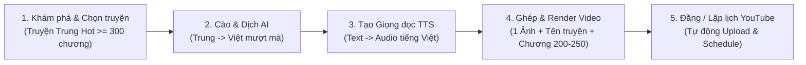

# ĐỀ BÀI & ĐẶC TẢ BÀI TOÁN: HỆ THỐNG TỰ ĐỘNG HÓA SẢN XUẤT VÀ ĐĂNG TẢI VIDEO TRUYỆN AUDIO YOUTUBE (AI NOVEL-TO-YOUTUBE AUTOMATION)

---

## 1. Bối cảnh & Đặt vấn đề (Business Context)

Hiện nay, nhu cầu nghe **Truyện Audio (Tiên hiệp, Huyền huyễn, Đô thị, Ngôn tình, Trọng sinh...)** trên YouTube tại Việt Nam rất lớn. Mỗi bộ truyện dài tập thường kéo dài hàng trăm đến hàng nghìn chương, mang lại lượng người nghe trung thành và thời lượng xem (Watch Time) rất cao cho các kênh YouTube.

Tuy nhiên, đối với **những người dùng phổ thông không có kinh nghiệm trước đây** (không biết tiếng Trung, không biết tìm nguồn truyện, không biết dựng video hay tối ưu kênh YouTube), việc tự xây dựng và vận hành một kênh YouTube truyện audio gặp phải 6 rào cản lớn:

1. **Không biết tìm kiếm và chọn lọc nguồn truyện:** Không biết các nền tảng truyện mạng lớn của Trung Quốc (như Qidian, Fanqie, 69shu, Zongheng...), không biết bộ truyện nào đang "hot" (thịnh hành) và dễ chọn nhầm truyện quá ngắn hoặc bị tác giả bỏ dở (dưới 300 chương), dẫn đến làm video nửa chừng thì hết nguồn.
2. **Rào cản ngôn ngữ và chất lượng dịch thuật:** Các công cụ dịch máy thông thường (Google Translate/Vietphrase thô) cho ra câu chữ ngượng nghịu, không phù hợp để đọc thành tiếng, và thường dịch lệch tên nhân vật, địa danh, cảnh giới giữa các chương.
3. **Tốn kém thời gian tạo giọng đọc (Audio):** Việc tự thu âm hoặc copy-paste thủ công từng chương vào các công cụ Text-to-Speech (TTS) cho hàng trăm chương truyện rất mất thời gian và dễ nhầm lẫn thứ tự chương.
4. **Không biết sử dụng phần mềm dựng video:** Người mới không biết dùng Premiere hay CapCut để gộp âm thanh của nhiều chương liên tiếp (ví dụ: gộp từ chương 200 đến chương 250 thành 1 tập dài) và ghép vào khung hình gồm **1 ảnh minh họa + tên truyện + số chương (VD: Chương 200 - 250)**.
5. **Không có kinh nghiệm vận hành kênh YouTube:** Không biết cách viết tiêu đề chuẩn định dạng truyện audio, viết mô tả, gắn thẻ (tags), gom danh sách phát (Playlist) theo từng bộ truyện và thường xuyên quên lịch đăng video định kỳ.
6. **Quy trình rời rạc, khó theo dõi tiến độ:** Khi làm cùng lúc nhiều bộ truyện (mỗi bộ hàng trăm chương), người dùng không nhớ được bộ truyện nào đã dịch đến chương mấy, đã ghép video đến chương nào và tập nào đã được xếp lịch đăng lên YouTube.

**Giải pháp:** Xây dựng một **Ứng dụng Web Tự động hóa Khép kín (All-in-One Web Application)** cho phép người dùng chưa có bất kỳ kinh nghiệm nào cũng có thể: **Chọn truyện Hot (≥ 300 chương) → Dịch AI sang tiếng Việt → Chuyển thành giọng đọc tiếng Việt → Ghép thành Video theo dải chương → Tự động đăng hoặc hẹn giờ đăng lên kênh YouTube.**

---

## 2. Mục tiêu của Hệ thống (System Objectives)

Hệ thống cần đáp ứng **6 mục tiêu cốt lõi** sau:

1. **Tổng hợp và gợi ý truyện mạng Trung Quốc đang Hot có độ dài an toàn:**
   - Tự động thu thập danh sách truyện thịnh hành từ các nền tảng truyện mạng lớn của Trung Quốc.
   - Hỗ trợ bộ lọc thông minh theo thể loại, thứ hạng độ hot và **số chương tối thiểu** (ví dụ: mặc định lọc các bộ đã có từ ≥ 300 chương trở lên) để người mới dễ dàng chọn đúng truyện tiềm năng.
2. **Tự động hóa dịch thuật truyện sang tiếng Việt bằng AI:**
   - Thu thập nội dung văn bản gốc tiếng Trung của từng chương và sử dụng mô hình AI (LLM) để dịch sang tiếng Việt trôi chảy, phù hợp văn phong kể chuyện audio.
   - Đảm bảo tính nhất quán về tên riêng (nhân vật, chiêu thức, cấp bậc tu luyện) xuyên suốt các chương của cùng một bộ truyện.
3. **Chuyển đổi văn bản sang giọng đọc tiếng Việt (Text-to-Speech - TTS):**
   - Tự động chuyển đổi nội dung chương truyện đã dịch sang file âm thanh giọng đọc tiếng Việt tự nhiên, cho phép chọn giọng đọc (nam/nữ, tốc độ đọc) chỉ với một thiết lập đơn giản.
4. **Tự động đóng gói và kết xuất (Render) Video theo cụm chương:**
   - Tự động gộp âm thanh của một dải chương liên tiếp (ví dụ: Chương 1–50, Chương 200–250) thành một tập video hoàn chỉnh.
   - Tự động tạo hình ảnh hiển thị trên video theo bố cục tinh gọn: **1 Ảnh minh họa bộ truyện + Tên bộ truyện + Dải số chương (ví dụ: `Chương 200 - 250`)**.
5. **Tích hợp YouTube và tự động hóa đăng tải / lập lịch xuất bản:**
   - Kết nối trực tiếp với kênh YouTube của người dùng.
   - Tự động điền Tiêu đề, Mô tả, Ảnh thu nhỏ (Thumbnail), Danh sách phát (Playlist) của bộ truyện và thực hiện **đăng ngay** hoặc **xếp lịch đăng tự động (Schedule)** theo khung giờ cố định.
6. **Tối ưu trải nghiệm cho người dùng không có kinh nghiệm (Zero-Experience Workflow):**
   - Giao diện trực quan, dẫn dắt từng bước đơn giản, tự động hóa tối đa các khâu kỹ thuật ngầm và cung cấp bảng theo dõi tiến độ sản xuất (chương nào đã dịch, tập nào đang render, video nào đã lên lịch đăng).

---

## 3. Luồng Nghiệp vụ Cốt lõi (End-to-End Pipeline)

| Bước | Tên công đoạn | Đầu vào (Input) | Xử lý của Hệ thống | Đầu ra (Output) |
|:---:|---|---|---|---|
| **1** | **Chọn truyện nguồn** | Tiêu chí lọc (Độ hot, Thể loại, Số chương tối thiểu ≥ 300) | Quét dữ liệu từ các trang truyện Trung Quốc, hiển thị danh sách gợi ý kèm thông tin tóm tắt đã dịch sẵn tiếng Việt | Bộ truyện được đưa vào danh sách dự án sản xuất |
| **2** | **Dịch thuật AI** | Nội dung chương truyện gốc (tiếng Trung) | Cào nội dung từng chương, gọi AI dịch sang tiếng Việt theo văn phong truyện đọc, đồng bộ từ điển tên riêng | Bản thảo chương truyện tiếng Việt hoàn chỉnh |
| **3** | **Tạo giọng đọc (TTS)** | Bản dịch tiếng Việt + Cấu hình giọng đọc | Chuyển hóa văn bản từng chương thành file âm thanh giọng đọc tiếng Việt | Các file Audio theo từng chương / cụm chương |
| **4** | **Ghép Video** | Audio dải chương (VD: 200–250) + 1 Ảnh minh họa + Tên truyện | Tự động vẽ khung hình (Ảnh + Tên truyện + Text `Chương 200 - 250`) và ghép với chuỗi Audio thành video `.mp4` | File Video hoàn chỉnh kèm Thumbnail tự động |
| **5** | **Đăng lên YouTube** | File Video + Kênh YouTube đích + Thời gian hẹn đăng | Tự sinh tiêu đề/mô tả chuẩn, đẩy video lên YouTube qua API và đặt lịch xuất bản (Scheduled Publish) | Video xuất hiện trên kênh YouTube đúng lịch hẹn |

---

## 4. Yêu cầu Thực hiện theo Quy trình Kiến trúc Hệ thống

Áp dụng đúng chuỗi truy vết tại `.agents/rules/1-core/workflow_phases.md` (xem chi tiết phương pháp luận tại [`md/analysis/SystemsThinking.md`](./analysis/SystemsThinking.md)), dự án sẽ lần lượt đi qua các bước:

1. **Bước 1 — Khảo sát & Hiểu bài toán (`2-analysis/1_problem_survey_5_questions.md`):** Trả lời 5 câu hỏi khảo sát bài toán, làm rõ các giả định và chốt các quyết định kiến trúc cốt lõi.
2. **Bước 2 — Truy vết & Bóc tách Tác nhân (`2-analysis/2_actor_identification_7_questions.md`):** Quét 7 câu hỏi truy vết Actor, chuẩn hóa danh sách Actor (Con người, Hệ thống ngoài như Nền tảng truyện Trung, AI/TTS, YouTube API) và các Tác vụ tự động.
3. **Bước 3 — Thiết kế Sơ đồ Ngữ cảnh DFD Level 0 (`2-analysis/3_dfd_level_0_standard.md`):** Lập bảng Actor - Hành động 7 cột (`[Vai trò - STT]`, Input/Output) và sơ đồ DFD Level 0.
4. **Bước 4 — Sơ đồ Phân rã Chức năng FDD (`2-analysis/4_fdd_and_rbac_standard.md`):** Xây dựng cây chức năng 3 cấp chuẩn MECE (`Động từ + Danh từ`) và Ma trận phân quyền RBAC.
5. **Bước 5 — Thiết kế Database (`3-database/`):** Lập bảng đặc tả 4 cột chuẩn cho toàn bộ Collection.
6. **Bước 6 — Thiết kế Tài liệu RESTful API (`4-api/`):** Đặc tả chi tiết các Endpoint phục vụ hệ thống.
